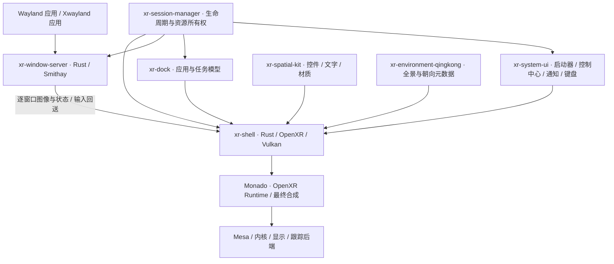

# UKUI XR 桌面软件栈 · r1

状态：架构设计。Shell、Dock、窗口服务和组件协议尚未实现；背景数据包已准备，构建记录与实际 XR 验收分开保存。首个目标是 openKylin 3.0 x86_64 开发虚拟机，后续再增加设备 profile。

## 产品与技术决策

以 Rust 实现空间 Shell，采用 `openxr` + `ash` 管理 OpenXR/Vulkan。Shell 负责统一空间场景、逐窗口布局、输入焦点、命中测试和帧提交。背景采用“晴空”最终六向拼接全景；空间 Dock、启动器、控制中心及窗口外框延续 UKUI 的蓝青、浅紫、圆角和通透材质。

独立打包以版本、接口和职责为边界。Dock 独立交付，但不创建第二个 OpenXR 会话。公共控件以 Rust 开发库、主题数据和版本化场景消息交付；组件通过 Shell 的渲染器呈现，不加载不稳定的 Rust 动态库 ABI。

首版使用直接 Vulkan 路线，减少 OpenXR swapchain、外部图像和引擎内部设备之间的适配层。Bevy/ECS、wgpu 或其他引擎后续可以作为内部实现候选，不成为组件协议的依赖。Rust 的 OpenXR 上游已提供与 ash 配合的 Vulkan 示例；这证明技术接口存在，不能替代本工程的实现验收。[openxrs 示例](https://github.com/Ralith/openxrs/blob/master/openxr/examples/vulkan.rs)、[ash](https://github.com/ash-rs/ash)。

## 分层与运行结构



有三类工作循环：Shell 按 OpenXR 帧时钟工作；窗口服务按 Wayland 事件与缓冲提交工作；Dock 和系统组件按状态变化工作。系统设置、应用搜索和 D-Bus 往返不进入 XR 渲染线程。

Shell 是应用级空间桌面；Monado 继续负责 runtime 级调度、光学与最终显示合成。窗口服务只管理其私有 Wayland socket 和 Xwayland；不获取物理 DRM master，不另开硬件采集。

## 仓库、源码包和二进制包

新增仓库名是设计提案，不能把下表当成已经存在的远程发布地址。精确状态见 [机器可读设计目录]({{ '/desktop-stack.json' | relative_url }})。

| 维护入口 | 源码包 | 二进制包 | 主要职责 |
|---|---|---|---|
| `xr-shell` | `xr-shell` | `xr-shell`（any）、`librust-xr-shell-protocols-dev`（all） | OpenXR、Vulkan、空间窗口、场景协议、焦点和呈现 |
| `xr-dock` | `xr-dock` | `xr-dock`（any） | 固定应用、任务列表、启动/激活、Dock 布局意图 |
| `xr-spatial-kit` | `xr-spatial-kit` | `librust-xr-spatial-kit-dev`、`xr-spatial-style-ukui`、`xr-spatial-assets`（all） | 控件模型、交互状态、字形与样式资产 |
| `xr-wayland` | `xr-wayland` | `xr-window-server`（any） | Wayland/Xwayland 应用、逐窗口缓冲、弹窗、输入法与剪贴板 |
| `xr-system-ui` | `xr-system-ui` | `xr-system-ui`（any），`xr-launcher`、`xr-control-center`、`xr-notifications`、`xr-keyboard`（all） | 一个组件宿主与系统适配器，多个可选组件定义包 |
| `xr-environments` | `xr-environments` | `xr-environment-qingkong`（all） | 独立环境数据与校验清单；本地数据包已准备 |
| 既有 `xr-session-manager` | 既有源码包 | 既有包，后续增加桌面会话入口 | 启停、服务依赖、沉浸应用切换、退出清理 |
| 既有 `openkylin-xr-integration` | 既有源码包 | 计划 `openkylin-xr-desktop`、`openkylin-xr-desktop-dev`（all） | 组合依赖、发行版默认值和开发 profile |

`xr-system-ui` 的组件定义包交付布局、图标引用、翻译与受支持的 action binding；业务逻辑在同版本宿主中。它们不是任意脚本插件，不要求四个独立常驻进程。复杂组件将来可按同一协议拆成独立客户端。

`xr-shell` 最小安装应能独立显示环境和内建恢复菜单。完整桌面元包再依赖 Dock、窗口服务和所选系统组件。Rust 库采用静态链接或源码开发包，运行包不依赖系统安装 Cargo；构建在固定 Cargo.lock 和校验后的离线缓存下进行。二进制包先验证 amd64，arm64 单独构建并验收，不从架构声明推导支持状态。

## Rust 代码组织

Shell 仓库内采用一个 Cargo workspace，内部 crate 不逐个生成常驻服务：

```text
xr-shell/
  crates/shell/          CLI、主循环、生命周期协调
  crates/xr-platform/    OpenXR instance/session/actions/spaces
  crates/render-vulkan/  ash、交换链、资源导入、字形与材质绘制
  crates/scene/          空间树、窗口布局、工作区、命中测试
  crates/input/          capture/focus、射线与鼠标适配
  crates/protocols/      由本仓唯一维护的 wire 格式与客户端类型
  crates/client/         Dock/system-ui 的客户端实现
  shaders/              离线编译的 SPIR-V 输入
  data/                 默认配置与 systemd 用户单元模板
  debian/               独立构建配方
```

`xr-platform` 是唯一接触 OpenXR 生命周期的模块；`render-vulkan` 将 unsafe Vulkan/FD 操作收敛在资源边界；`scene` 和 `input` 不依赖具体 GPU。主循环使用 OpenXR predictedDisplayTime 定位空间，最后才解析世界变换；组件只发送布局与交互意图，不逐帧发送头姿。

Rust crate 的版本和系统包版本分别管理。协议开发包由 Shell 仓库拥有；Kit 不依赖 Shell 内部模块。Shell、Dock 和 system-ui 以稳定协议交互，组件升级不要求进程内 Rust ABI 兼容。

## 渲染、文字和环境

默认画面分为环境、应用画布、窗口外框、Dock/系统 UI 和指针几层。优先合成为一个 projection layer；文字密集的活动窗口可按 runtime 能力提升到 Quad。Cylinder、equirect2 和其他扩展均按能力查询启用；超过 `maxLayerCount` 时回到 projection 合成，不按窗口数无界创建 composition layer。[OpenXR 规范](https://registry.khronos.org/OpenXR/specs/1.1/html/xrspec.html)。

设计采用清晰的文字与克制的景深，而不是默认全屏实时高斯模糊。首版半透明磨砂使用环境预过滤、粗糙度与边缘高光；它不等同于对身后任意应用窗口做真实模糊。正文走完整 Unicode shaping、回退字体、字形缓存和可测量的抗锯齿流程；MSDF 是后续可选字形实现，不作为中文/输入法支持的替代品。

“晴空”作为单目远景：4K、2:1 equirectangular、sRGB 输入，在线性空间合成。保持世界方位，仅忽略 HMD 平移；转头应看到不同方向，不能把天空锁在视野里。原资产的 50 m 球和观察高度用于预览，Shell 应由每眼视线方向采样天空，而不是继承一个会产生假地面视差的近景球体。全景包含画出的地面与反射，但没有真实地面几何、碰撞或 6DoF 视差。

普通路径直接使用全景纹理；GLB 作为资产预览/互操作输入，不要求把其中 16128 个三角形全部搬入 Shell。首次加载验证 manifest 和 SHA-256；失败时提供内建纯色环境与恢复菜单，并明确诊断，不通过联网下载补齐帧循环资源。

## 窗口与图像路径

首个窗口服务采用 Rust + Smithay，提供私有 Wayland 显示。先做 `wl_shm` + `xdg-shell` 的可见逐窗口路径，再接 DMA-BUF；Xwayland、复杂弹窗、中文输入和剪贴板按独立条目验收。[Smithay 后端](https://smithay.github.io/smithay/smithay/backend/index.html)、[DMA-BUF 接口](https://smithay.github.io/smithay/smithay/wayland/dmabuf/index.html)。

窗口服务拥有 wl_surface、commit/configure 序列和应用状态；Shell 拥有三维布局。Shell 请求 resize 后，旧内容可暂时缩放，但只有应用确认并提交新尺寸后才能替换其有效像素尺寸。`xdg_popup`、subsurface、CSD、输入区域和光标表面必须保留自己的协议语义，不能只抓一张顶层纹理。

缓冲传输通过 Unix FD 通道：描述 DRM fourcc、modifier、各 plane 的 offset/stride、尺寸、alpha/色彩、damage、帧身份及同步方式。Shell 等待 acquire 同步后使用，GPU 完成读取后回送 release；Wayland 服务据此释放应用缓冲，不能收到 IPC 就提前释放。OpenXR runtime swapchain 与 Wayland buffer 是不同资源域；当前 Venus 的同 GPU OPAQUE_FD 验收不构成通用 DMA-BUF 导入的验收。[Wayland 缓冲生命周期](https://wayland.freedesktop.org/docs/html/apa.html#protocol-spec-wl_buffer)。

DMA-BUF 快路径只有在格式/modifier 与同步实际可用时启用。第一版正确性基线是共享内存加显式拷贝；显式同步扩展在实现后协商，未经验证的隐式同步不作为默默启用的兼容路径。缓冲所有权、FD 规则与消息顺序见 [组件接口设计]({{ '/wiki/xr-desktop-protocol/' | relative_url }})。

## 输入、Dock 与系统组件

空间使用米、弧度、右手坐标和 OpenXR reference space。二维应用保留自己的逻辑像素；射线交点经窗口逆变换映射到 surface 坐标。视觉布局可以使用角尺寸目标，再根据距离计算世界尺寸；不将 dmm 描述为 OpenXR 或行业标准单位。

默认提供手柄 aim/grip、select、squeeze、menu 和 scroll actions；手部关节与凝视输入是能力可选项。没有眼动时可用头部射线。凝视/悬停不会自动转移键盘焦点；点击激活窗口后键盘才送入对应 Wayland seat。鼠标捕获、相对指针、拖动中的 pointer capture、丢焦后的 release/cancel 统一由 Shell 仲裁。

Dock 默认位于前下方，提供受限、可关闭的延迟跟随，窗口保持世界锚定。Dock 订阅窗口模型和应用索引，发出 LaunchApp、ActivateWindow、MinimizeWindow 等意图；Shell 是窗口状态权威，Dock 重连后重新取快照。内建恢复菜单始终可由 Shell 本地输入唤出，Dock 退出不影响 XR 帧提交。

Launcher 通过 `.desktop`/XDG 应用信息启动应用，不拼接任意 shell 命令。控制中心调用 NetworkManager、音频和电源适配器；有权限要求的操作保留系统授权语义。虚拟键盘向当前焦点输入接口提交文本或键事件，不经全局 uinput 注入。中文候选、预编辑和组合输入由 Wayland text-input/input-method 与发行版 IME 配合验收。

通知的总线所有权按会话决定：原生 XR 登录会话可提供唯一通知服务；嵌套在 UKUI 开发会话时，不抢占现有 `org.freedesktop.Notifications`。系统组件安装默认不注册竞争的全局桌面服务。

## 会话、原生 XR 应用与恢复

保留既有 `xr-session-manager` 的生命周期权威。新增桌面 target 管理 shell、窗口服务、Dock 和 system-ui 的启动顺序与环境；组件安装不自动启动 XR，不修改系统默认 OpenXR runtime。

Shell 是一个前台 OpenXR 应用。启动另一个原生 XR 应用时，由 session-manager 协调 Shell 让出会话、启动目标应用，并在退出后恢复桌面。是否能作为 overlay 与其他会话共存必须单独核对 runtime 扩展和焦点行为；不能因为 Monado 编译了 overlay 就把它作为桌面必备能力。

开发 profile 使用现有 Monado 模拟头显/手柄和滑块，明确传入 runtime JSON、ICD 及必要的环境；安装包本身不硬编码 VM 私有前缀。Kasm 的 `sw,linear` WSI 兼容设置只属于对应开发呈现 profile。VNC/Kasm 是开发观察入口，不进入最终 Linux 应用窗口的图像传输链路。

发行版完整依赖闭包还需要 OpenXR loader 和原生 Monado service/client/runtime manifest 的独立包。目前发布索引中的 Monado 包以 SteamVR driver 为主，开发 VM 的私有 SDK 也不是已完成的发行版 runtime 包。桌面元包实现时必须补全并验证这些依赖，不能仅添加一个指向现有 SteamVR driver 包的依赖就宣布可安装。

退出顺序为停止输入路由、结束/取消交互、释放持有缓冲与 GPU 资源、结束 XR session、停止自己拥有的组件。崩溃恢复按单元处理：Dock/system-ui 断连取消其所有 capture；窗口服务退出后移除其 surfaces；Shell 退出由 session-manager 收敛会话资源。不得误停既有 UKUI 会话或其他 runtime 实例。

## 开发阶段与可见验收

| 阶段 | 交付内容 | 完成证据 |
|---|---|---|
| S0 设计与资产 | 本架构、包/接口目录、晴空环境包 | 数据摘要、独立 Deb 内容/解包验证；不能称 Shell 已运行 |
| S1 Rust 场景 | Rust Shell 的 OpenXR/Vulkan 帧循环、全景、镜像、退出 | QEMU 中真实双眼环视，场景朝向正确；验证层、资源清理与实际截图 |
| S2 Dock/Kit | 最小场景协议、Button/Card/Icon/Text、独立 Dock | 真实射线点击、拖动、Dock 断开重连；独立包构建/安装/移除 |
| S3 Linux 应用 | 一个 shm Wayland 窗口、焦点、外框、resize | 原生应用逐窗口显示，configure/commit、键鼠、popup 和关闭行为 |
| S4 系统组件 | 启动器、控制中心、通知、键盘、工作区 | 逐项 OS 操作、中文预编辑/候选、权限、组件启停；数据不依赖网页 |
| S5 图形优化 | DMA-BUF、同步、帧预算与 Quad 提升 | 实际格式/modifier、缓冲复用和释放证据；应用/合成/浏览器呈现分别计量 |
| S6 系统集成 | openKylin 元包与 amd64/arm64 构建配方 | 干净发行版依赖闭包、升级卸载、会话切换；每种设备另行验收 |

优先顺序是 S1 → S2 → S3，先让背景、交互和一个 Linux 应用构成可操作的闭环，再扩展系统组件。现有 QEMU 的 UKUI/Venus/Monado 与浏览器观察链路是开发底座；尚无本设计的 Rust Shell 图像、Dock 或 Wayland 窗口验收结果。

## 本轮保留的决策

- 采用直接 Vulkan，而非先引入完整游戏引擎；为外部图像与 OpenXR 资源生命周期保留明确控制。
- 采用一个 XR session 和统一 renderer；Dock 独立进程、系统 UI 共用一个宿主。
- 采用 retained scene IPC，避免进程内动态 Rust 插件和逐组件 OpenXR session。
- 首版 projection + shm 正确性路径；Quad、DMA-BUF、手部追踪和 overlay 逐项协商验收。
- 晴空沿用最终六向全景，不再拆成假几何或采用镜像方向；它作为远景环境资产独立更新。

以上是本工程的设计选择，引用的上游能力只作为实现依据。
